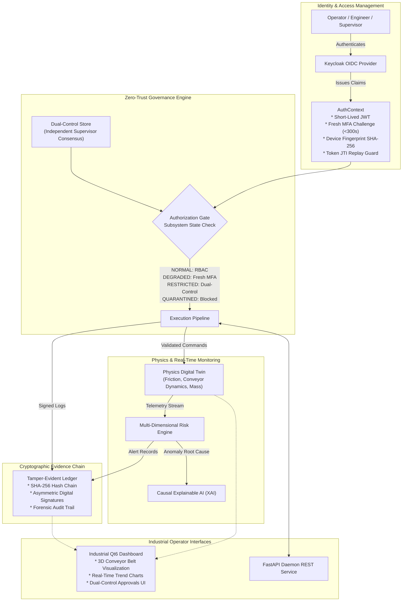

# SecureGuard Governance Model (SGGM)

[](https://github.com/verx-09/SecureGuard-Governance-Model-SGGM-/actions/workflows/ci.yml)
[](https://www.python.org/)
[](https://doc.qt.io/qtforpython/)
[](LICENSE)
[](https://github.com/astral-sh/ruff)

**SecureGuard Governance Model (SGGM)** is a zero-trust, defense-in-depth cybersecurity governance architecture and high-precision Human-Machine Interface (HMI) console designed for mission-critical **Cyber-Physical Systems (CPS)** and **Industrial Control Systems (ICS)**.

By combining multi-tiered authorization gates, fresh multi-factor authentication (MFA), dual-control supervisor consensus, a physics-informed digital twin, and a cryptographically sealed, tamper-evident audit ledger, SecureGuard prevents unauthorized physical actuation, detects telemetry spoofing, and guarantees end-to-end accountability.

---

## Architecture Overview



---

## Key Pillars & Features

### 1. Multi-Tiered Zero-Trust Authorization Gates
Physical subsystems operate within four deterministic operational states:
- **`NORMAL`**: Standard Role-Based Access Control (RBAC) across operators, engineers, and supervisors.
- **`DEGRADED`**: Sensor anomalies or elevated error rates activate step-up MFA challenge checks (< 300s window).
- **`RESTRICTED`**: High-risk operations require dual supervisor approval from two distinct authenticated supervisors.
- **`QUARANTINED`**: Complete physical command isolation. No commands are accepted until on-site manual reset.

### 2. Defense-in-Depth Identity Assurance
- **MFA Freshness Validation**: Stolen long-lived tokens cannot trigger elevated commands without active, fresh biometric/authenticator re-verification (`mfa_challenge_ts`).
- **Device Fingerprinting**: Session binding computes a SHA-256 fingerprint over client headers and IP origins.
- **Token Freshness**: Automated token expiry enforcement (default 900 seconds) guards against replay and stale session hijacking.

### 3. Cryptographically Sealed Tamper-Evident Evidence Ledger
- Every state transition, operator command, sensor breach, and supervisor override is recorded in an immutable, append-only JSONL ledger (`evidence_log.jsonl`).
- Each entry is linked to the previous record via a cryptographic **SHA-256 hash chain**.
- Tampering or record deletion breaks chain verification instantly (`python verify_log.py`).

### 4. Physics-Informed Digital Twin & Causal XAI
- Mathematical simulations validate command physics (e.g., motor torque, belt velocity, package inertia) before and during execution.
- Discrepancies between commanded state and physical sensor readings trigger immediate anomaly flags.
- **Causal Explainable AI (XAI)** pinpoints root causes (sensor drift, actuator failure, physical obstruction) instead of black-box alerting.

### 5. High-Precision Industrial Qt6 HMI Console
- Built with **PySide6** and **pyqtgraph** with dark-mode industrial styling (`industrial_theme.py`).
- Real-time 3D conveyor animation rendered via **PyOpenGL** (`qt_view3d.py`).
- Low-latency real-time telemetry plotting with configurable refresh budgets.

---

## Directory Structure

```text
SecureGuard-Governance-Model-SGGM/
+---- .github/                       # GitHub workflows and issue/PR templates
|   +---- workflows/ci.yml           # Automated CI testing and linting matrix
|   +---- ISSUE_TEMPLATE/            # Bug report and feature request templates
|   \---- PULL_REQUEST_TEMPLATE.md   # Pull request checklist template
+---- archive/                       # Historical and deprecated components
+---- logs/                          # Development session audit records
+---- tests/                         # Complete automated test suite & cryptographic fixtures
|   +---- fixtures/test_keys.py      # Test-only RSA keypair fixtures
|   +---- conftest.py                # Test harness with automated ledger isolation
|   +---- test_dashboard_evidence.py # Dashboard evidence logging test
|   +---- test_evidence_chain.py     # Cryptographic hash chain tests
|   +---- test_keycloak_auth.py      # JWT authentication and MFA validation tests
|   +---- test_pipeline.py           # Subsystem pipeline and authorization tests
|   +---- test_profile_switch.py     # Profile switching and session tests
|   \---- test_ui_compliance.py      # Industrial HMI design-system compliance guards
+---- app_paths.py                   # Platform data path resolution & isolation
+---- causal_xai.py                  # Causal Explainable AI for anomaly diagnosis
+---- charts_tab.py                  # PySide6/pyqtgraph real-time telemetry charts
+---- config.py                      # Centralized environment & timeout configurations
+---- crypto_audit.py                # Digital signatures and cryptographic verification
+---- dashboard_qt.py                # Main PySide6 Industrial HMI dashboard
+---- dashboard_sync.py              # Real-time state synchronization between HMI and backend
+---- digital_twin.py                # Digital twin model definitions
+---- docker-compose.yml             # Keycloak + API + Dashboard multi-service stack
+---- Dockerfile.api                 # Headless FastAPI daemon container recipe
+---- Dockerfile.dashboard           # PySide6 GUI container recipe
+---- DOCUMENTATION.md               # Master consolidated architecture, decisions & guide
+---- dual_control_store.py          # Dual supervisor approval store
+---- evidence_log.py                # SHA-256 hash-chained tamper-evident audit ledger
+---- hardware_telemetry.py          # Sensor input processing and rate calibration
+---- industrial_theme.py            # High-contrast industrial HMI palette and typography
+---- keycloak_auth.py               # JWT parsing, MFA validation, and device binding
+---- keycloak_client.py             # Keycloak OIDC client helper & test token generation
+---- main.py                        # FastAPI REST API daemon entrypoint
+---- main_qt.py                     # PySide6 desktop GUI entrypoint
+---- multi_dimensional_risk.py      # Real-time risk scoring engine
+---- physics_digital_twin.py        # Physical equation solver for conveyor dynamics
+---- pipeline.py                    # Command validation pipeline & authorization gates
+---- pyproject.toml                 # Standard packaging and tool configuration
+---- qt_view3d.py                   # PyOpenGL 3D conveyor visualization
+---- requirements.txt               # Production dependencies
+---- requirements-dev.txt           # Testing and development dependencies
+---- SecureGuard.spec               # PyInstaller single-binary distribution recipe
+---- startup_profile.py             # Environment verification and diagnostic profiles
+---- state_machine.py               # Deterministic subsystem state transitions
+---- timeout_utils.py               # Dynamic timeout handling and circuit breakers
\---- verify_log.py                  # CLI forensic verification tool for audit ledgers
```

---

## Quick Start

### 1. Prerequisites

- Python 3.10, 3.11, or 3.12
- Git
- Virtual environment (`venv`)

### 2. Installation

```bash
# Clone the repository
git clone https://github.com/verx-09/SecureGuard-Governance-Model-SGGM-.git
cd SecureGuard-Governance-Model-SGGM-

# Create a virtual environment
python -m venv .venv

# Activate the virtual environment
# Windows:
.venv\Scripts\activate
# Linux/macOS:
source .venv/bin/activate

# Install dependencies
pip install -r requirements.txt
```

To install development and testing tools:
```bash
pip install -r requirements-dev.txt
```

### 3. Environment Configuration

Copy the example configuration file:
```bash
cp .env.example .env
```

Adjust parameters such as Keycloak endpoints or MFA freshness windows as needed.

---

## Running the Application

### Option A: Desktop Industrial HMI Console (Recommended)

Launch the PySide6 industrial operator dashboard:
```bash
python main_qt.py
```
*On Windows, you can also run `launch_secureguard_qt.bat`.*

### Option B: Headless FastAPI Daemon

For headless edge gateways or REST integration:
```bash
uvicorn main:app --host 0.0.0.0 --port 8000 --reload
```
Interactive OpenAPI documentation is available at `http://localhost:8000/docs`.

### Option C: Docker Compose Stack

Run the full stack (Keycloak + SecureGuard API + Dashboard):
```bash
docker-compose up --build
```
For detailed containerization instructions, see [docs/CONTAINERS.md](docs/CONTAINERS.md).

---

## Testing & Compliance

The repository includes a comprehensive suite of **103+ automated tests** verifying authentication gates, cryptographic ledger integrity, dual-control workflows, and UI compliance:

```bash
# Run all tests
pytest

# Run tests with verbose output and coverage
pytest -v --cov=.
```

> [!NOTE]
> Tests run with full isolation via [conftest.py](conftest.py). Temporary isolated directories are used during tests to ensure that production ledgers (`evidence_log.jsonl`) and databases (`secureguard.db`, `dual_control.db`) are never contaminated.

---

## Cryptographic Ledger Verification

You can cryptographically audit and verify the forensic evidence ledger at any time using the standalone verification tool:

```bash
python verify_log.py
```
This utility walks the SHA-256 hash chain, validates asymmetric digital signatures, checks sequence continuity, and alerts on any unauthorized modifications.

---

## Configuration Reference

| Environment Variable | Default | Description |
| -------------------- | ------- | ----------- |
| `SECUREGUARD_MFA_FRESHNESS` | `300` | Window in seconds for valid step-up MFA challenge |
| `SECUREGUARD_TOKEN_MAX_AGE` | `900` | Maximum token lifetime in seconds before re-authentication |
| `SECUREGUARD_DUAL_CONTROL` | `1` | Enforce dual supervisor consensus for critical states (1=on, 0=off) |
| `SECUREGUARD_STARTUP_PROFILE`| `production` | Startup verification profile (`production` or `demo`) |
| `SECUREGUARD_DATA_DIR` | *(local)* | Root directory for ledger and SQLite databases |
| `SG_PIPELINE_TIMEOUT` | `900.0` | Execution pipeline timeout budget in seconds |
| `SG_VIEW3D_FPS` | `30.0` | Target animation frame rate for 3D visualization |
| `SG_CHART_REFRESH_MS` | `30000` | Trend chart redraw cadence in milliseconds |
| `PYQTGRAPH_QT_LIB` | `PySide6` | Authoritative Qt binding (`PySide6` required) |

---

## Packaging

SecureGuard can be compiled into a standalone, single-binary executable using PyInstaller:

```bash
pyinstaller SecureGuard.spec
```
The output binary will be generated at `dist/SecureGuard.exe`.

---

## Technical Documentation & Architecture Deep-Dives

Complete, unabridged technical documentation and architecture records are maintained in the **[documentations/](documentations/)** directory:

- 📑 **[documentations/decisions.md](documentations/decisions.md)** -- In-depth Architecture Decision Records (ADRs 1-10) detailing rationale, constraints, and tradeoffs.
- 🔄 **[documentations/flow.md](documentations/flow.md)** -- Complete code execution flows, sequence graphs, and runtime timer call trees.
- 🐳 **[documentations/containers.md](documentations/containers.md)** -- Container topography, headless Xvfb configuration, and Docker Compose guide.
- ⚙️ **[documentations/analysis_and_run_guide.md](documentations/analysis_and_run_guide.md)** -- Operational run guide, auth matrices, and API endpoints.
- 🔬 **[documentations/safety_twin_report.md](documentations/safety_twin_report.md)** -- Physics digital twin and process safety validation model.
- 🗺️ **[documentations/advancement_roadmap.md](documentations/advancement_roadmap.md)** -- Five-phase engineering progression roadmap.
- ⏱️ **[documentations/dashboard_restoration_plan.md](documentations/dashboard_restoration_plan.md)** -- Dynamic timeout handling and HMI restoration plan.

For a unified single-file overview, see **[DOCUMENTATION.md](DOCUMENTATION.md)**.

---

## License

This project is proprietary and subject to a restricted access and distribution license. Access, use, and distribution are permitted solely to authorized individuals and entities -- see the [LICENSE](LICENSE) file for details.
